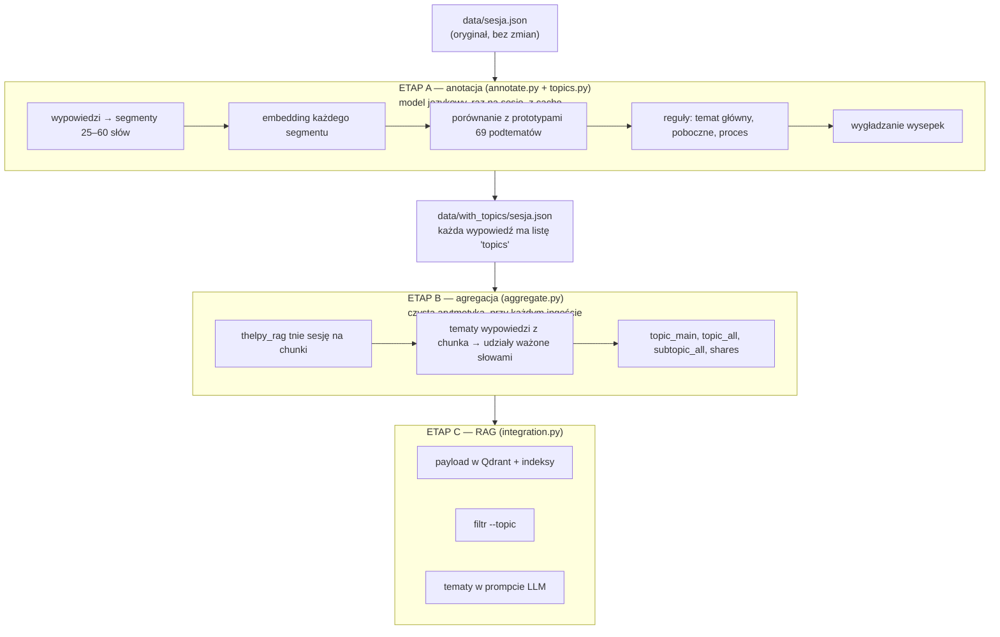
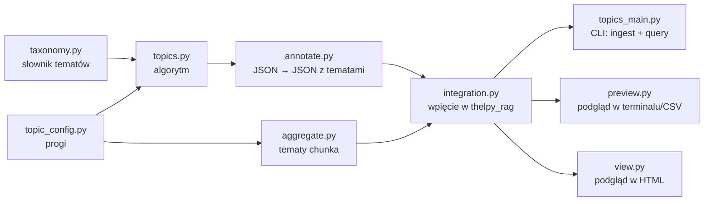
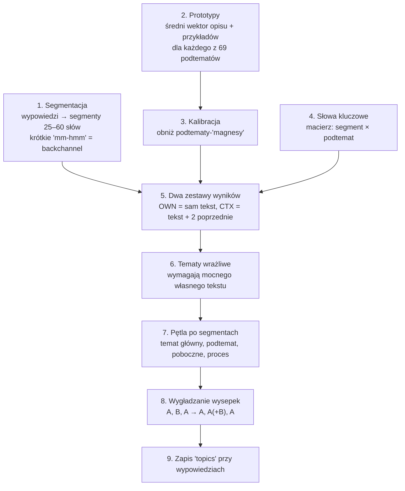
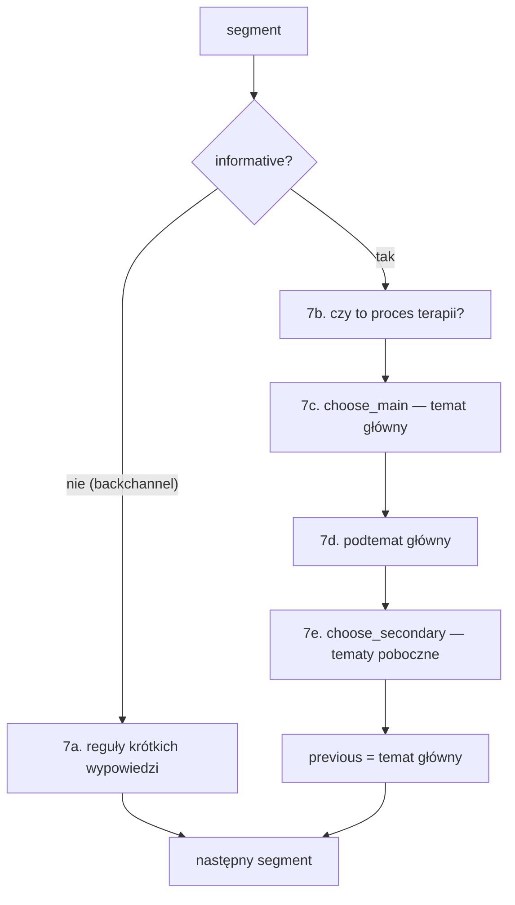
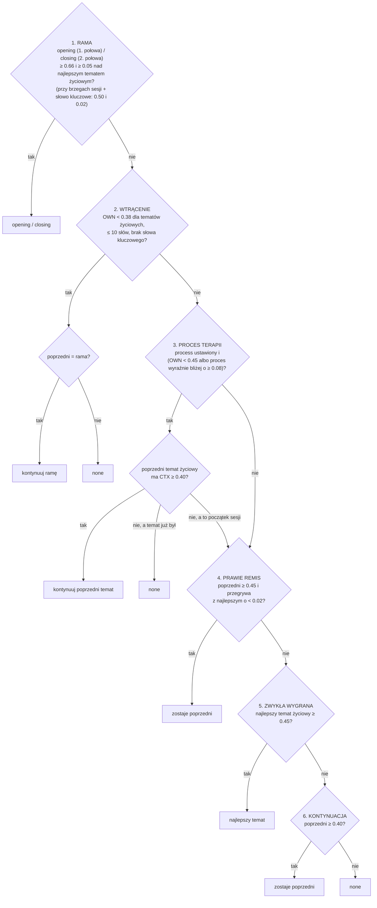
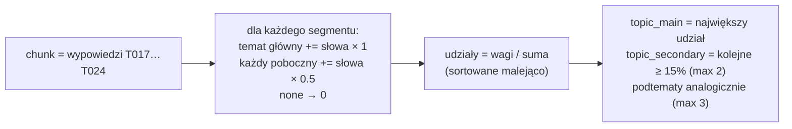
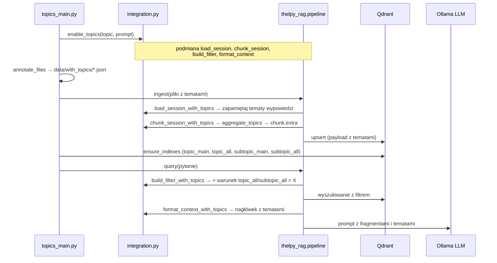

# thelpy_topics — tematy rozmowy terapeutycznej w RAG

Moduł przypisuje tematy (np. *alkohol*, *matka*, *praca*) do każdego fragmentu sesji terapeutycznej
i dokleja je do chunków w Qdrant. Dzięki temu:

- można szukać tylko w chunkach o danym temacie (`--topic alcohol`),
- LLM widzi przy każdym fragmencie, o czym on jest,
- można obejrzeć, jak tematy zmieniają się w trakcie sesji.

Moduł **nie zmienia plików `thelpy_rag`** — podmienia kilka jego funkcji w trakcie działania.

---

## Spis treści

1. [Obraz całości w jednym schemacie](#1-obraz-całości-w-jednym-schemacie)
2. [Mapa plików](#2-mapa-plików)
3. [Etap A: anotacja sesji (raz na sesję)](#3-etap-a-anotacja-sesji-raz-na-sesję)
4. [Algorytm przypisywania tematów krok po kroku](#4-algorytm-przypisywania-tematów-krok-po-kroku)
5. [Etap B: od tematów wypowiedzi do tematów chunka](#5-etap-b-od-tematów-wypowiedzi-do-tematów-chunka)
6. [Etap C: integracja z RAG](#6-etap-c-integracja-z-rag)
7. [Przykład od początku do końca](#7-przykład-od-początku-do-końca)
8. [Ściąga z progów](#8-ściąga-z-progów)
9. [Komendy](#9-komendy)
10. [Uwagi](#10-uwagi)

---

## 1. Obraz całości w jednym schemacie

Wszystko dzieje się w trzech etapach. Najważniejsza idea: **tematy liczone są raz, na całej sesji**
(etap A), a dopiero potem — szybko i bez modelu — agregowane do chunków o dowolnym rozmiarze (etap B).



To samo w wersji tekstowej:

```
sesja.json ──► [A] annotate ──► with_topics/sesja.json ──► [B] ingest + aggregate ──► Qdrant ──► [C] query / LLM
                (model, wolne,      (tematy per wypowiedź)      (szybkie, per chunk)        (filtr, prompt)
                 z cache)
```

---

## 2. Mapa plików



| plik | co to jest | logika? |
|---|---|---|
| [taxonomy.py](taxonomy.py) | **słownik**: 17 tematów głównych, 69 podtematów (opisy, słowa kluczowe, przykłady EN/PL), zdania neutralne | nie, same dane |
| [topic_config.py](topic_config.py) | **wszystkie progi i ustawienia** w jednym miejscu | nie, same liczby |
| [topics.py](topics.py) | **algorytm**: segmentacja, embeddingi, prototypy, reguły decyzji, wygładzanie | tak — serce modułu |
| [annotate.py](annotate.py) | czyta sesję w formacie `thelpy_rag`, uzupełnia role i czasy, uruchamia algorytm, zapisuje kopię z tematami, cache | tak |
| [aggregate.py](aggregate.py) | tematy wypowiedzi z chunka → tematy chunka | tak, prosta arytmetyka |
| [integration.py](integration.py) | podmienia funkcje `thelpy_rag` na wersje z tematami | tak |
| [preview.py](preview.py) | tematy chunków w terminalu + CSV, bez Qdranta i Ollamy | narzędzie |
| [view.py](view.py) | tematy chunków jako strona HTML z filtrami | narzędzie |
| [../topics_main.py](../topics_main.py) | odpowiednik `main.py` z tematami | CLI |

### Słownik tematów ([taxonomy.py](taxonomy.py))

Tematy główne są trzech rodzajów:

| rodzaj (`kind`) | tematy | rola |
|---|---|---|
| **life** — życie klienta | substances, physical, mental, family, partner, parenting, social, school, work, law, leisure, eating, sexuality, pets | mogą być tematem głównym i pobocznym |
| **frame** — rama rozmowy | opening (powitanie, small talk), closing (pożegnanie, następna wizyta) | tylko temat główny, nigdy poboczny |
| **process** — proces terapii | process (powód wizyty, refleksje, cele, gotowość do zmiany, organizacja sesji) | **osobna warstwa**, nie zastępuje tematu |

Każdy temat główny ma podtematy, np.:

```
substances ── alcohol, smoking, cannabis, hard_drugs, prescription_misuse, behavioural_addiction, recovery
mental ────── anxiety, depression, anger, self_esteem, trauma, grief, suicidal, self_harm, ocd, psychosis, identity, coping
family ────── mother, father, siblings, family_general
...
```

Każdy podtemat ma:

```python
"alcohol": {
    "main": "substances",
    "label_pl": "alkohol", "label_en": "alcohol",
    "desc_en": "Drinking alcohol: how much and how often, ...",      # opis
    "desc_pl": "Picie alkoholu: ile i jak często, ...",
    "keywords_en": ["alcohol*", "drink", "beer*", ...],              # * = dowolna końcówka
    "keywords_pl": ["alkohol*", "piję", "piw*", "urwany film", ...], # spacja = fraza
    "examples_en": ["I usually have five or six beers every night after work.", ...],
    "examples_pl": ["Zwykle wypijam pięć, sześć piw każdego wieczoru po pracy.", ...],
}
```

- **opisy + przykłady** → z nich powstaje *prototyp* (wektor) podtematu — to główny sygnał,
- **słowa kluczowe** → mały bonus i kilka reguł pomocniczych,
- **zdania neutralne** (`neutral_examples_en/pl`) → kalibracja (krok 3 algorytmu).

---

## 3. Etap A: anotacja sesji (raz na sesję)

Plik: [annotate.py](annotate.py). Wejście: plik sesji w formacie `thelpy_rag/loader.py`.
Wyjście: kopia w `data/with_topics/` z listą `topics` przy każdej wypowiedzi.

```mermaid
flowchart TD
    S[sesja.json] --> F{is_fresh?<br/>kopia istnieje, jest nowsza<br/>i ma ten sam topics_version}
    F -- tak --> OUT[użyj istniejącej kopii]
    F -- nie / --force --> R[turn_rows<br/>niepuste wypowiedzi → tabela]
    R --> G[guess_roles<br/>brak speaker_role → zgadnij terapeutę]
    G --> T[fill_starts / fill_ends<br/>uzupełnij brakujące czasy]
    T --> M[TopicModel.score<br/>ALGORYTM — sekcja 4]
    M --> ADD[add_topics<br/>dopisz 'topics' do każdej wypowiedzi]
    ADD --> SAVE[zapisz data/with_topics/sesja.json]
```

**Szczegóły kroków:**

| krok | co robi | po co |
|---|---|---|
| `turn_rows` | wypowiedzi → tabela (`turn`, `turn_id`, `speaker_id`, `role`, `text`, `start`, `end`); `turn_id` jak w `thelpy_rag` (`T001`, …) | żeby potem dopasować tematy do chunków po `turn_id` |
| `guess_roles` | gdy brak roli: dla każdego mówcy *udział pytań + udział słów „you / ty / pan / pani”*; najwyższy wynik = terapeuta | rola jest zapisywana jako `topic_role` |
| `fill_starts`, `fill_ends` | brak startu → koniec poprzedniej; brak końca → start następnej albo `słowa / 2,5 słowa/s` | czas jest potrzebny: pozycja w sesji (powitanie/pożegnanie), wygładzanie (30 s) |
| `TopicModel` | ładuje model zdaniowy, prototypy i kalibrację **raz** dla wielu sesji | ładowanie modelu jest wolne |
| cache | `topics_version` = hash MD5 plików `taxonomy.py`, `topic_config.py`, `topics.py` | zmiana progu albo słownika → automatycznie liczy od nowa |

Co ląduje w każdej wypowiedzi (jedna pozycja na **segment** wypowiedzi):

```json
{
  "turn_id": "T017", "speaker_role": "client", "text": "...",
  "topic_role": "client",
  "topics": [
    {"part": 0, "words": 27, "start": 112.3, "end": 123.1,
     "main": "substances", "main_sub": "alcohol",
     "secondary": ["social"], "secondary_subs": ["party_scene"],
     "process": "", "source": "własny tekst"}
  ]
}
```

---

## 4. Algorytm przypisywania tematów krok po kroku

Plik: [topics.py](topics.py), funkcje `make_segments` i `score_segments`.
Tu jest cała „inteligencja”. Brzmi jak dużo, ale to **9 kroków**, z czego większość to przygotowanie liczb,
a decyzja zapada w kroku 7.



### Krok 1. Segmentacja (`make_segments`, `chunk_turn`)

Decyzja nie jest podejmowana dla całej wypowiedzi, tylko dla **segmentu** — kawałka 25–60 słów.

```
Wypowiedź klienta (90 słów):
"W pracy jest ciężko, szef ciągle krzyczy... [40 słów]. A wieczorem po prostu piję, żeby zapomnieć... [50 słów]"
                │
                ▼ podział na zdania (. ! ? —), sklejanie do ≥ 25 słów, nigdy > 60
   ┌──────────────────────────┐   ┌──────────────────────────┐
   │ segment 0 (40 słów)      │   │ segment 1 (50 słów)      │
   │ → work / job             │   │ → substances / alcohol   │
   └──────────────────────────┘   └──────────────────────────┘
```

- wypowiedź z **mniej niż 4 słowami treściowymi** (po odrzuceniu „yeah, mm, okay, tak, no, wiesz…”)
  to **backchannel** (`informative = False`) i zostaje jednym segmentem,
- krótki ogon (< 12 słów) dokleja się do poprzedniego segmentu,
- czas wypowiedzi dzieli się między segmenty proporcjonalnie do słów.

**Po co?** Jedna długa wypowiedź może zawierać dwa tematy; a model zdaniowy najlepiej działa na kawałkach
długości kilku zdań.

### Krok 2. Prototypy podtematów (`build_prototypes`)

Dla każdego podtematu embedujemy (model `paraphrase-multilingual-mpnet-base-v2`):

```
desc_en + desc_pl + examples_en (≈10) + examples_pl (≈10)   →   ~22 wektory   →   średnia   →   PROTOTYP
```

Model jest wielojęzyczny, więc polskie i angielskie zdania o piciu leżą blisko siebie — jeden prototyp
działa w obu językach.

**Wynik segmentu dla podtematu** = podobieństwo cosinusowe embeddingu segmentu do prototypu
(liczba od ok. 0 do 1; w praktyce 0.3 = „nic wspólnego”, 0.6 = „wyraźnie o tym”).

### Krok 3. Kalibracja „magnesów” (`neutral_bias`)

Problem: niektóre podtematy (np. *coping*) mają ogólne przykłady i są trochę podobne do **każdego** zdania.

Rozwiązanie:

```
1. embeduj ~40 zdań neutralnych ("Nie wiem, chyba tak już po prostu jest.")
2. dla każdego podtematu: przyciąganie = średnie podobieństwo do tych zdań
3. bias = max(0, przyciąganie − średnie przyciąganie wszystkich podtematów)
4. od każdego wyniku tego podtematu odejmij bias
```

Obniżane są tylko podtematy przyciągające ponadprzeciętnie; pozostałe nie są podbijane.

### Krok 4. Słowa kluczowe (`keyword_pattern`, `keyword_matrix`)

Każde słowo kluczowe → wyrażenie regularne z granicami słowa:

| słowo w słowniku | łapie |
|---|---|
| `drink*` | drink, drinks, drinking |
| `alkohol*` | alkohol, alkoholu, alkoholem |
| `urwany film` | dokładnie tę frazę |
| `pocięłam się` | „pocięłam się” **i** „się pocięłam” (polskie „się” w obu kolejnościach) |

Wynik: macierz 0/1 *segment × podtemat*. Słowa kluczowe **nie decydują same** — dają bonus +0.02 do wyniku
i są używane w kilku regułach (krótkie wypowiedzi, tematy poboczne, wygładzanie, wtrącenia).

### Krok 5. Dwa zestawy wyników: OWN i CTX

Dla każdego segmentu liczone są dwa wektory wyników (69 podtematów):

```
OWN = sim(segment, prototypy) − bias + 0.02·słowa_kluczowe            ← sam tekst segmentu

CTX = sim(kontekst, prototypy) − bias + 0.02·słowa_kluczowe            ← tekst + to, co padło wcześniej
      gdzie kontekst = 0.7·segment[i] + 0.2·segment[i−1] + 0.1·segment[i−2]
```

**Po co kontekst?** Zdanie samo w sobie bywa bez tematu:

```
T: Ile pan zwykle pije w tygodniu?         ← wyraźnie: alcohol
K: Kilka razy w tygodniu, czasem więcej.   ← OWN: nic konkretnego;  CTX: alcohol ✔
```

Zasady kontekstu:

- tylko **wstecz** (nigdy przyszłe zdania),
- tylko segmenty informatywne (bez „mm-hmm”),
- segment **ogólny** (OWN < 0.45 dla każdego tematu życiowego) mocniej opiera się na kontekście:
  wagi 0.6 / 0.25 / 0.15 zamiast 0.7 / 0.2 / 0.1.

**Wynik tematu głównego** = **maksimum** z wyników jego podtematów (`topic_scores`).
Np. substances = max(alcohol, smoking, cannabis, …).

> Decyzje o temacie zapadają na **CTX**. OWN służy do sprawdzenia, czy *sam tekst* coś mówi
> (wtrącenia, proces terapii, krótkie wypowiedzi, tematy wrażliwe).

### Krok 6. Tematy wrażliwe (`require_own_score`)

Podtematy: suicidal, self_harm, psychosis, ocd, purging, restriction, binge_eating, sexual_problems,
sexual_compulsion, sexual_health, prescription_misuse, pregnancy.

```
jeśli OWN[podtemat wrażliwy] < 0.55:
    OWN[podtemat] −= 1.0
    CTX[podtemat] −= 1.0      ← praktycznie wypada z gry
```

**Po co?** Zdania „to zagraża mojemu zdrowiu”, „muszę to przemyśleć” są semantycznie bliskie myślom
samobójczym, a kontekst rozlewałby temat wrażliwy na sąsiednie zdania. Teraz temat wrażliwy dostaje tylko
segment, który **sam** o tym mówi. (Na 133 sesjach AnnoMI: fałszywe „myśli samobójcze” 38 → 6.)

### Krok 7. Pętla po segmentach — tu zapada decyzja

Segmenty są przetwarzane **po kolei**. Pętla pamięta:

- `previous` — temat główny poprzedniego segmentu informatywnego,
- `started` — czy w sesji był już jakikolwiek temat życiowy,
- `position` — gdzie jesteśmy w sesji (0 = początek, 1 = koniec).



#### 7a. Krótkie wypowiedzi (backchannel)

Sprawdzane po kolei, pierwsza pasująca reguła wygrywa:

```
1. OWN tematu życiowego ≥ 0.55               → ten temat           ("Drugs, I guess.")
2. słowo kluczowe i jego podtemat ≥ 0.42     → ten podtemat        ("Znam Family Bar, tak.")
3. OWN ramy ≥ 0.55                           → opening / closing   ("Thank you, bye!")
4. nie było jeszcze żadnego segmentu         → none
5. w przeciwnym razie                        → ODZIEDZICZ temat główny i poboczne poprzedniego segmentu
```

Najczęściej działa reguła 5: „mm-hmm” po rozmowie o alkoholu dostaje alkohol.

#### 7b. Czy segment to proces terapii?

Na **surowym** podobieństwie własnego tekstu (bez kalibracji):

```
jeśli najlepszy podtemat procesu ≥ 0.45  i  jest wyższy niż każdy inny temat:
    process = ten podtemat   (np. "readiness", "goals_change", "reflection")
```

To osobna etykieta — segment może mieć `process = "readiness"` **i** temat główny `substances`.

#### 7c. Temat główny (`choose_main`)

Reguły po kolei, **pierwsza pasująca wygrywa**. Każda zapisuje swoje uzasadnienie w `main_rule`.



Sens poszczególnych reguł:

| reguła | przykład | sens |
|---|---|---|
| 1. rama | „Dzień dobry, proszę usiąść, jak minęła podróż?” | powitanie i pożegnanie muszą **wyraźnie** wygrać, bo każde zdanie jest trochę „rozmową” |
| 2. wtrącenie | „Jeśli wiesz, o co mi chodzi.” | krótkie zdanie bez treści nie przenosi tematu dalej |
| 3. proces | „W skali 1–10, na ile jest pan gotowy?” | skala dotyczy tematu, o którym właśnie mowa — **może go kontynuować, ale nie wprowadza nowego** |
| 4. remis | alcohol 0.51 vs. social 0.52 | zapobiega migotaniu tematów co segment |
| 5. wygrana | „Piję codziennie po pracy.” | normalny przypadek |
| 6. kontynuacja | słabsze zdanie w środku wątku | temat nie znika, dopóki ma ≥ 0.40 |

#### 7d. Podtemat główny

Najlepszy podtemat (według CTX) **wewnątrz** wybranego tematu głównego.
Temat `substances` → porównaj alcohol, smoking, cannabis, … → `alcohol`.

#### 7e. Tematy poboczne (`choose_secondary`)

Maksymalnie 2, tylko tematy życiowe, tylko gdy jest temat główny. Temat zostaje poboczny, gdy:

```
(a) CTX ≥ 0.48  i  CTX ≥ temat_główny − 0.06          "blisko tematu głównego"
lub
(b) w tekście jest jego słowo kluczowe i podtemat ≥ 0.42  "słowo ze słownika"
```

Przykład: „Piję głównie na imprezach ze znajomymi” → główny **substances/alcohol**, poboczny **social/party_scene**.

#### Pole `source` — skąd wzięła się decyzja

| wartość | znaczenie |
|---|---|
| `własny tekst` | najlepszy temat samego tekstu = wybrany temat |
| `kontekst wcześniejszy` | temat wynika głównie z poprzednich zdań |
| `kontynuacja` | reguła 4 lub 6 (albo 3) |
| `odziedziczony` | krótka wypowiedź przejęła temat |
| `wygładzenie` | zmienione w kroku 8 |
| `brak tematu` | none |

### Krok 8. Wygładzanie wysepek (`smooth_islands`)

Po pętli: krótkie „wysepki” innego tematu w środku jednego wątku są wchłaniane.

```
przed:   alcohol ── alcohol ── [ work ] ── alcohol ── alcohol
po:      alcohol ── alcohol ── alcohol(+work jako poboczny) ── alcohol ── alcohol
```

Warunki (każdy segment wysepki):

- wysepka ma **1–2 segmenty**, przed i po niej jest **ten sam** temat A, w odstępie ≤ 30 s
  (segmenty `none` pomiędzy są pomijane),
- A pasuje do wysepki: CTX[A] ≥ 0.40 i A jest najwyżej 0.10 poniżej B,
- tekst wysepki **nie** nazywa B słowem kluczowym („moja mama”) i B < 0.60,
- *wyjątek*: gdy A i B praktycznie remisują (różnica ≤ 0.025) — wygładzane zawsze.

Temat B **nie ginie** — przechodzi do tematów pobocznych. Krótkie „mm-hmm” po wysepce, które
odziedziczyły B, też są poprawiane. Rama i `none` nigdy nie są zmieniane.

### Krok 9. Zapis

Każdy segment → słownik w `topics` swojej wypowiedzi (patrz [sekcja 3](#3-etap-a-anotacja-sesji-raz-na-sesję)).

---

## 5. Etap B: od tematów wypowiedzi do tematów chunka

Plik: [aggregate.py](aggregate.py). Działa przy każdym ingeście, **bez modelu**, więc zmiana
`--n-turns` czy `--size` nie wymaga liczenia tematów od nowa.



Przykład:

| segment | słowa | główny | poboczny |
|---|---|---|---|
| T017.0 | 40 | substances | social |
| T018.0 | 3 („mm-hmm”) | substances (odziedziczony) | social |
| T019.0 | 20 | work | — |
| T020.0 | 8 | none | — |

```
substances = 40 + 3              = 43
social     = 0.5·40 + 0.5·3      = 21.5
work       = 20                  = 20
suma = 84.5   →   substances 0.509, social 0.254, work 0.237

topic_main = substances,  topic_secondary = [social, work]   (oba ≥ 0.15)
topic_none_share = 8 / 71 = 0.113
```

Pola dodawane do payloadu chunka:

| pole | przykład | użycie |
|---|---|---|
| `topic_main` | `"substances"` | indeks Qdrant |
| `topic_main_label` | `"Substances and addictions"` | |
| `topic_secondary` | `["social", "work"]` | |
| `topic_all` | `["substances", "social", "work"]` | indeks Qdrant, **filtr `--topic`** |
| `topic_labels` | etykiety EN | prompt LLM |
| `topic_shares` | `{"substances": 0.509, ...}` | prompt LLM, widok HTML |
| `subtopic_main`, `subtopic_secondary`, `subtopic_all`, `subtopic_labels`, `subtopic_shares` | analogicznie | indeksy, filtr |
| `topic_none_share` | `0.113` | jaka część słów chunka nie ma tematu |
| `topic_process_share` | `0.0` | jaka część to proces terapii |

---

## 6. Etap C: integracja z RAG

Plik: [integration.py](integration.py). `enable_topics()` podmienia 4 funkcje `thelpy_rag`
(**monkey-patching**) — oryginały są zapamiętane w słowniku `original` i wywoływane w środku.



| oryginał w `thelpy_rag` | zamiennik | co dodaje |
|---|---|---|
| `pipeline.load_session` | `load_session_with_topics` | zapamiętuje `{turn_id: topics}` w `state["turns"]` |
| `pipeline.chunk_session` | `chunk_session_with_topics` | dla każdego chunka: tematy jego `turn_ids` → `aggregate_topics` → payload |
| `pipeline.build_filter` | `build_filter_with_topics` | przy `--topic X`: `must += (topic_all = X OR subtopic_all = X)` |
| `llm.format_context` | `format_context_with_topics` | pod nagłówkiem fragmentu linia z tematami |

Co widzi LLM:

```
[annomi_64, T017-T024, session date: 2024-03-02]
(topics: Substances and addictions 51%, Friends and social life 25%, Work, money and housing 24%; subtopics: alcohol, party_scene, job)
Client: ...
```

Dwie ważne rzeczy:

- `enable_topics()` musi być wywołane **przed** `from thelpy_rag.pipeline import ingest, query`
  (dlatego w `topics_main.py` ten import jest w środku `main()`),
- `--topic` przyjmuje klucz tematu (`substances`) **albo** podtematu (`alcohol`) z `taxonomy.py`.

---

## 7. Przykład od początku do końca

Fragment sesji (uproszczony; wyniki w tabeli są ilustracją działania reguł, nie wydrukiem z modelu —
prawdziwe decyzje zobaczysz w `python -m thelpy_topics.preview`):

```
T001  T: Dzień dobry, proszę usiąść. Jak minęła droga?
T002  K: Dobrze, dziękuję.
T003  T: Co pana do nas sprowadza?
T004  K: Żona mówi, że za dużo piję. Wieczorami wypijam kilka piw, w weekendy więcej.
T005  T: Mhm.
T006  K: No i w pracy jest teraz ciężko, szef ciągle naciska.
T007  K: Wtedy wieczorem tym bardziej sięgam po piwo.
T008  T: W skali od 1 do 10, na ile chciałby pan to zmienić?
T009  K: Sześć, może siedem.
```

| wyp. | segment | co się dzieje | wynik |
|---|---|---|---|
| T001 | informatywny | początek sesji (position ≈ 0), wysoki wynik opening, słowo kluczowe → **reguła 1 (rama)** | opening / greeting |
| T002 | backchannel | OWN ramy ≥ 0.55 → **7a, reguła 3** | opening |
| T003 | informatywny | krótkie (5 słów), bez tematu życiowego → **reguła 2**, a poprzedni to rama → kontynuacja ramy. Gdyby było dłuższe: proces (`reason_for_visit`), temat jeszcze nie padł → reguły zwykłe, nic ≥ 0.45 → none | opening (albo none), process = reason_for_visit |
| T004 | informatywny | alcohol wysoko (OWN i CTX) + słowa „piję”, „piw*” → **reguła 5**; partner („żona”) przez słowo kluczowe → **poboczny (b)** | substances / alcohol, poboczny partner |
| T005 | backchannel | brak treści → **7a, reguła 5** | substances (odziedziczony) |
| T006 | informatywny | work wyraźnie wygrywa → **reguła 5** | work / job |
| T007 | informatywny | alcohol („piwo”) → **reguła 5** | substances / alcohol |
| T008 | informatywny | proces (`readiness`), OWN tematów życiowych słabe → **reguła 3**: poprzedni (substances) ma CTX ≥ 0.40 | substances (kontynuacja), process = readiness |
| T009 | backchannel | „Sześć, może siedem” → **7a, reguła 5** | substances (odziedziczony) |

Krok 8 (wygładzanie): T006 to wysepka `work` między `substances` (T004–T005) i `substances` (T007).
Ale tekst T006 zawiera słowo kluczowe „pracy” / „szef” → **nie jest wygładzany**, `work` zostaje tematem głównym.
Gdyby T006 brzmiało „No i ogólnie jest teraz ciężko”, a `substances` pasowałoby niemal tak samo dobrze,
zostałoby zmienione na `substances` z `work` jako tematem pobocznym.

Chunk T001–T009 (`--n-turns 9`) po agregacji:

```
topic_main = substances,  topic_secondary = [work, partner?]  (zależnie od udziałów ≥ 15%)
subtopic_main = alcohol
topic_none_share > 0 (T003),  topic_process_share > 0 (T003, T008)
```

---

## 8. Ściąga z progów

Wszystkie w [topic_config.py](topic_config.py). Zmiana któregokolwiek → zmiana `topics_version`
→ ponowna anotacja przy następnym uruchomieniu.

| grupa | parametr | wartość | znaczenie |
|---|---|---|---|
| segmentacja | `target_words` / `max_words` | 25 / 60 | długość segmentu |
| | `min_words` | 4 | mniej słów treściowych = backchannel |
| kontekst | `weight_self`, `weight_previous` | 0.7, [0.2, 0.1] | mieszanie z poprzednimi segmentami |
| | `generic_weight_*` | 0.6, [0.25, 0.15] | to samo dla segmentów ogólnych |
| temat główny | `main_threshold` | 0.45 | minimum na nowy temat |
| | `continue_threshold` | 0.40 | minimum na utrzymanie poprzedniego |
| | `keep_margin` | 0.02 | „prawie remis” |
| rama | `frame_threshold` / `frame_margin` | 0.66 / 0.05 | powitanie/pożegnanie w środku sesji |
| | `edge_share`, `edge_threshold`, `edge_margin` | 12%, 0.50, 0.02 | łatwiej przy brzegach sesji |
| wtrącenia | `empty_threshold` / `empty_max_words` | 0.38 / 10 | krótkie zdania bez treści → none |
| proces | `process_threshold` | 0.45 | etykieta procesu |
| | `process_lead` | 0.08 | proces wyraźnie bliżej niż temat życiowy |
| krótkie wypowiedzi | `short_turn_threshold` | 0.55 | własny temat zamiast dziedziczenia |
| | `short_keyword_threshold` | 0.42 | ... albo słowo kluczowe |
| poboczne | `secondary_threshold` / `secondary_margin` | 0.48 / 0.06 | blisko tematu głównego |
| | `keyword_secondary_threshold` | 0.42 | albo słowo kluczowe |
| | `max_secondary` | 2 | |
| wrażliwe | `own_min_score` | 0.55 | własny tekst musi o tym mówić |
| wygładzanie | `island_length`, `island_gap_sec` | 2, 30 s | jak długa wysepka, jak blisko |
| | `island_margin`, `island_tie`, `island_keep` | 0.10, 0.025, 0.60 | kiedy wolno/trzeba wygładzić |
| słowa kluczowe | `keyword_bonus` | 0.02 | bonus do wyniku |
| chunk | `secondary_weight` | 0.5 | waga tematu pobocznego |
| | `chunk_min_share` | 0.15 | minimalny udział tematu pobocznego chunka |
| | `chunk_max_secondary` / `_subs` | 2 / 3 | |

---

## 9. Komendy

```bash
pip install -r requirements.txt   # zawiera sentence-transformers

# tylko anotacja (zapis do data/with_topics/)
python -m thelpy_topics.annotate data/annomi_64.json
python -m thelpy_topics.annotate data/sessions/ --force

# podgląd tematów chunków bez Qdranta i Ollamy (+ CSV)
python -m thelpy_topics.preview data/annomi_64.json --n-turns 8

# podgląd w przeglądarce
python -m thelpy_topics.view --file data/annomi_64.json --n-turns 8
python -m thelpy_topics.view --collection thelpy_turns8

# pełny RAG z tematami
python topics_main.py --file data/annomi_64.json --chunking turns --n-turns 8 --query "What drugs does he use?" --ask
python topics_main.py --chunking turns --n-turns 8 --skip-ingest --topic alcohol --query "how much does he drink"

# testy
pytest tests_topics/
```

---

## 10. Uwagi

- Z [topics.py](topics.py) pipeline RAG używa tylko sekcji *segments*, *embeddings*, *dictionary* i *scoring*.
  Sekcje *explanation* (`occlusion`, `add_explanations`), *aggregation* i *blocks* (`presence`, `topic_blocks`, …)
  oraz `load_annomi` pochodzą z Topics_v4 i służą do analiz/wykresów — ale ich zmiana też zmienia
  `topics_version` i wymusza ponowną anotację.
- `allowed_frame(scores, position)` nie używa `scores` — opening/closing wybierane jest tylko po połowie sesji.
- Docstring `encode` mówi o `outputs/`, a cache embeddingów faktycznie leży w `data/topic_cache/`.
- Cały katalog `data/` jest w `.gitignore` (kopie z tematami, cache, strony HTML).
